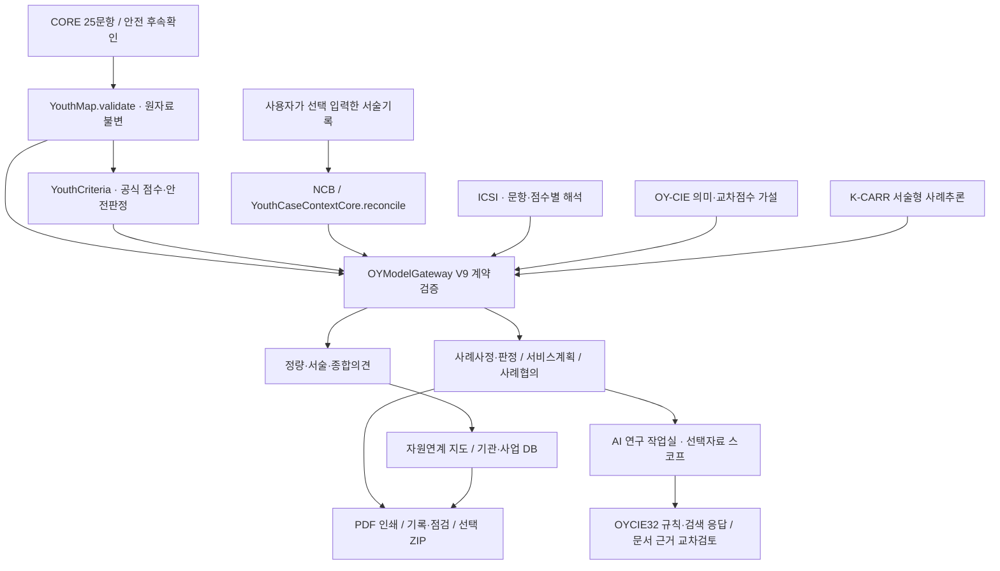

# OY-RALS 5단계 통합 개편 · 아키텍처 및 검수 기준

- 기준일: 2026-10-26
- 성격: GitHub Pages 운영판의 단계별 기능 개편 · 개발·검수 기록
- 대상: `docs/youth-risk/`
- 절대명제: **CORE 25문항 × 0~4점(원점수 100점), 미상 처리와 공식 안전판정은 UI·추론 모델과 독립적으로 보존한다.**
- 기획·개발·저작: 김지훈 · 오산세교종합사회복지관

## 1. 사용자에게 보이는 5단계와 실제 실행 상태

| 사용자 단계 | 내부 상태·구성 | 기존 기능 보존 | 신설·개선 |
|---|---|---|---|
| 01 척도 평가·결과 | 입력: `flow.js stage=1`; 결과: `stage=2, view=result` | `assessment.html`, CORE, 안전확인 | 정량만 / 서술만 / 종합의견 3탭, 독립 출력 |
| 02 자원연계 지도 | `stage=2, view=map` | 기존 `support.html` iframe, 기관 매핑·연계확인 | 메인 단계 독립, 이전 결과와 연결 |
| 03 사례 톺아보기 | `stage=3` | `journey-model-v88.js`, `OYRelations`, 계획·회의 | 사례사정·판정 / 서비스계획 추천 / 통합사례 진행 |
| 04 AI 연구 작업실 | `stage=5` | OY-CIE V3.2 연구 응답·근거 검토, 역할 선택 | 자료 선택·자유 질문·모델 결과 연결·PDF |
| 05 기록 및 점검 | `stage=4` | `workbench.html`·회차별 기록·재사정 | 탐색 명칭·출력 접근성 |

이 단계 매핑은 기존 스코어 계산·자원연계·사례기록과의 호환성을 위해 의도적으로 내부 상태 번호와 분리한다.

## 2. 통합 데이터·모델 연결

### 모델·기능별 책임

| 모델·구성 | 담당 범위 | 절대 경계 |
|---|---|---|
| CORE / `YouthCriteria` | 25문항 평가, 안전·미상 판정 | 다른 AI 모델은 원점수·안전판정을 덮어쓸 수 없음 |
| ICSI / `OYCIESemanticV2` | 문항별 응답 의미, 문항 간 동시 보고의 검토가설 | 동시 보고 ≠ 인과·검증된 위험확률 |
| NCB / `YouthCaseContextCore` | 서술의 부정·가정·과거·관찰 단서 분리 | 서술을 신규 확정 점수로 취급하지 않음 |
| K-CARR V8.1 | 서술형 사례 분석 및 면담 질문 | 공식 진단·판정 금지 |
| OY-CIE | 의미 해석·복합 가설·실무 확인과제·근거 교차검토 | **규칙·검색 기반 모델**로, 자체 훈련된 생성형 LLM이 아님 |
| ICMS / `YouthPlanning` | 계획안·우선지원 방향 | 미상 응답만 있는 영역에 자동 서비스계획을 생성하지 않음 |
| Relations / `OYRelations` | 가계도·생태도 관계초안 | 동거·관계·이용상태는 실무자가 확정 |
| `OYModelGateway` | 모델 계약·점수 보존·오류 검증 | 미검증 응답을 결정으로 승격하지 않음 |

## 3. 정량 / 서술 / 종합의견 분리 설계

1. **정량:** 공식 CORE 원점수, 확인 문항 수, 미상 수, 영역별 확인합계, 25문항 응답 및 공식 안전확인만 표시한다. 서술형 점수 보정, 추가 인과 추론 또는 K-CARR을 포함하지 않는다.
2. **서술:** NCB가 입력자료의 근거·미확인·부정·시점을 분리하고, 입력된 경우 K-CARR 검토 내용을 보여 준다. 입력하지 않았다면 분석 보류를 명시한다.
3. **종합의견:** 원점수 불변 조건으로 정량·서술 불일치, CIE 보조 가설, 안전·강점·우선지원 방향을 대조한다.

서술 해석과 종합의견의 내용은 개인정보가 포함될 수 있다. PDF·외부 AI로 옮기기 전 자동 비식별 결과를 **사람이 다시 확인**해야 한다.

## 4. AI 연구 작업실: 연결과 한계

- `ai-workbench-stage-v1.js`는 평가·서술·종합의견·사례사정·서비스계획·자원연계 후보를 선택하게 한다.
- CORE와 안전판정은 항상 포함하고 서술기록은 기본 제외한다.
- 선택 범위는 `OYModelGateway.analyze`에서 파생된 **검토 자료**이며 공식 점수는 재계산하지 않는다.
- `cie-flow-v32.js`가 질문과 사용자 역할을 받아 `OYCIE32.run`을 실행한다. `linkedDocuments`는 질문 의도에 따라 참고하는 자료이며 확정 사실·실제 서비스 수혜로 승격하지 않는다.
- 저장·전송 없이 브라우저 내에서 문서 참조, 규칙·검색 응답, 요청문 복사, PDF 인쇄가 가능하다.
- **외부 GPT/Claude/Gemini를 iframe으로 읽거나 로그인된 AI의 답변을 자동 수집하지 않는다.** 실제 LLM 직접 호출은 별도의 안전한 백엔드와 법적·개인정보 검토가 필요하다.

## 5. 출력물·UI/UX

- Apple Design Skill(Apple HIG의 비공식 미러)을 참고해 타이포그래피, 여백, 정렬, 모바일 스크롤 탐색, 터치 타깃, 키보드 초점 상태를 개선.
- `apple-web-hig-v5.css`, `ai-workbench-stage-v1.css`로 기능 코드와 표현 코드를 분리.
- 정량·서술·종합의견은 **현재 결과 PDF**와 **통합 사례보고서 PDF** 버튼에서 브라우저 인쇄 기능으로 출력.
- 기록 및 점검은 `workbench.html`의 기존 작성·문서 기능을 보존.
- 전체 ZIP·비식별 JSON 기능도 보존. PDF는 서버의 직접 생성 파일이 아니라 브라우저의 'PDF로 저장' 출력물이다.
- 서비스 연계 지도는 구조 개편에서도 기존 지도·데이터를 재사용하며 기관의 현재 접수 가능 여부는 반드시 직접 확인한다.

## 6. 검수 체크리스트

- [x] JavaScript 문법 점검 및 기존 함수 인터페이스 보존
- [x] 기존 25문항 채점, 안전판정, 미상 계산 함수 변경 없이 유지
- [x] 5단계 이동 및 하위 3결과 탭
- [x] 사례사정·판정, 서비스계획 추천, 통합사례 진행안
- [x] 가계도·생태도 작성 구조 보존
- [x] CIE 연구 단계에서 선택자료·역할·질문 전달
- [x] 현재 결과 PDF / 통합 보고서 PDF 인쇄 버튼
- [x] 기존 자원연계 지도 및 기록 화면 경로 보존
- [x] GitHub Actions의 모델 계약 검사와 CORE·연계 회귀검사 실시
- [x] 실제 Chromium 1280px·390px UI 회귀검사 실시

최종 검사 결과와 배포 상태는 저장소의 GitHub Actions 최신 `main` 실행에서 확인해야 한다. 과거 성공 기록을 이후 수정 전체의 성공으로 간주하지 않는다.

## 7. 공개·실증 관련 한계

- 본 도구는 **TEST / 비표준화**이며 실제 청소년에게 적용한 실증 타당도·효과성이 확보되었다고 주장할 수 없다.
- 합성 사례·난수 회귀검사와 실제 학생 대상 타당화 연구는 구분한다.
- 규칙·검색·템플릿 기반 해석은 유용한 실무 초안이지만 생성형 LLM 자체가 아니며 진단·신고·개입 확정 기능도 아니다.
- GitHub Pages는 공개 웹 배포이므로 개인 식별정보와 민감사례의 영속 저장소로 사용하지 않는다.
- 복지자원 서비스의 대상·관할·접수가능성은 자원 DB의 안내만으로 확정하지 않는다.
